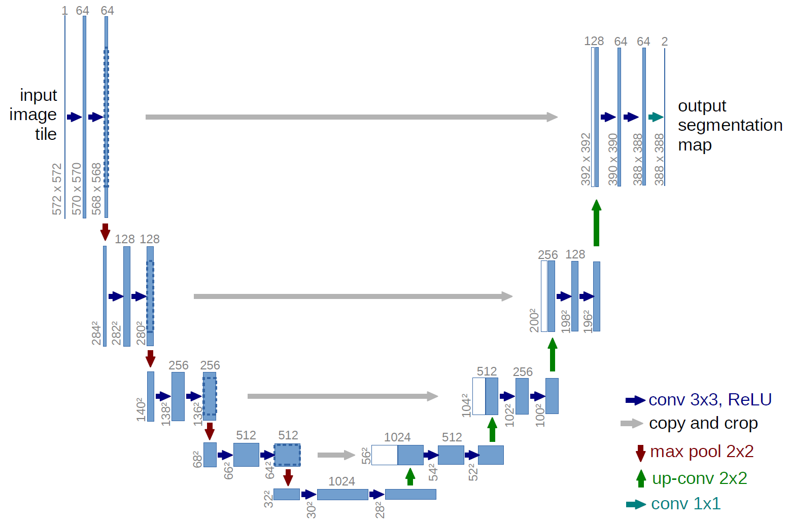
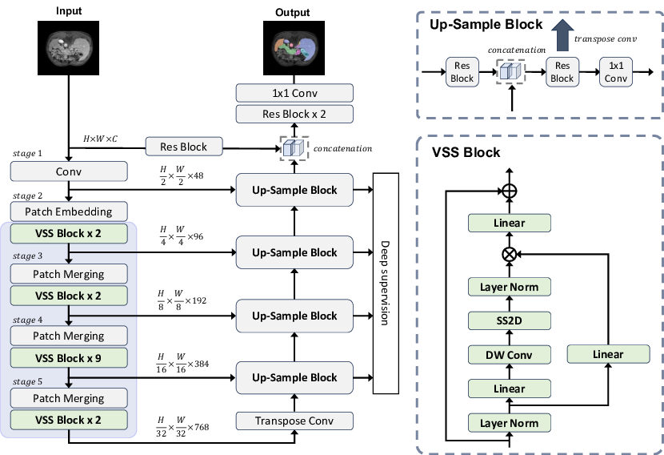
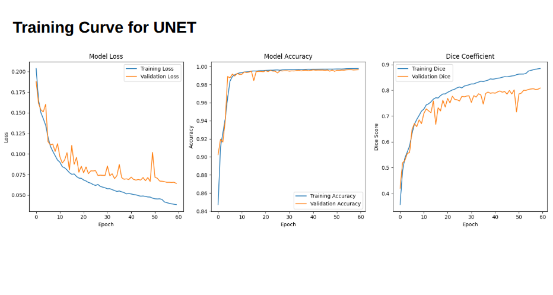
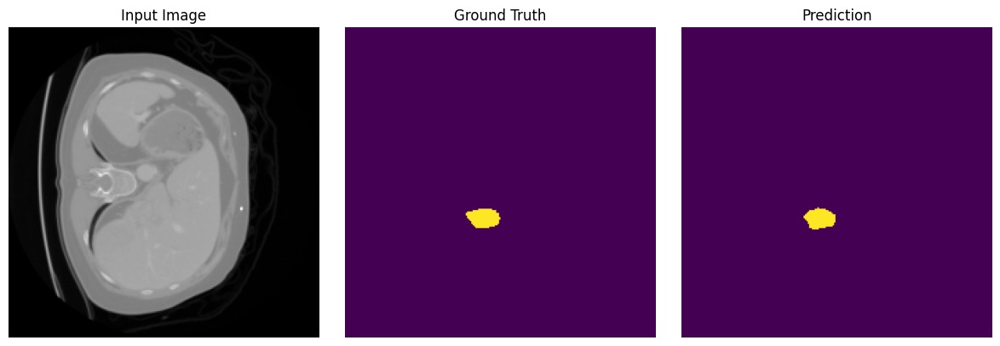
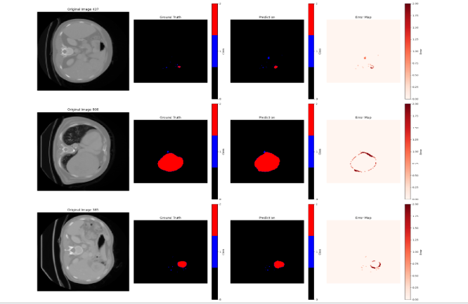
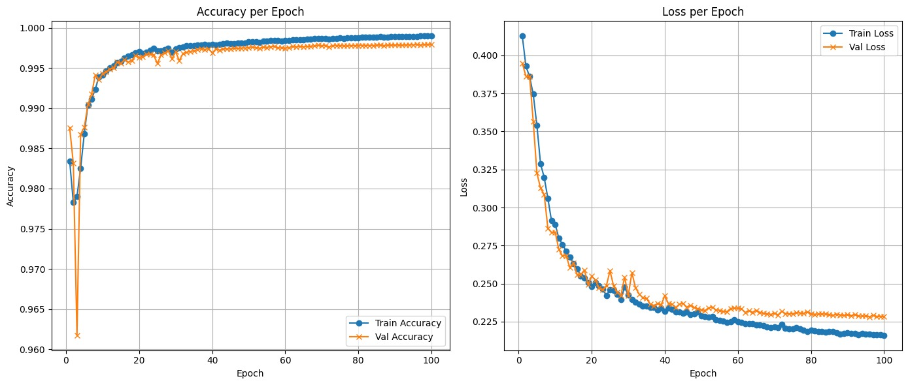

# Hepatic Vessel and Tumor Segmentation

A deep learning project for automatically segmenting **hepatic blood vessels** and **liver tumors** from abdominal CT scans.

The project uses the **Medical Segmentation Decathlon Task08 – Hepatic Vessel** dataset. The original 3D NIfTI medical volumes are converted into 2D axial slices and used to train a multi-class semantic segmentation model.

## Project Overview

Accurate segmentation of hepatic vessels and tumors can support:

* Liver disease assessment
* Tumor localization
* Surgical planning
* Treatment monitoring
* Computer-assisted medical image analysis

This project performs pixel-wise classification of CT images into three classes:

| Class          | Label | Description                    |
| -------------- | ----: | ------------------------------ |
| Background     |     0 | Non-target regions             |
| Hepatic Vessel |     1 | Blood vessels inside the liver |
| Tumor          |     2 | Hepatic tumor regions          |

> **Disclaimer:** This project is intended for academic and research purposes only. It must not be used as a substitute for professional medical diagnosis.
 ## Model Architectures

This project explores two deep learning architectures for semantic segmentation of hepatic vessels and liver tumors.

### U-Net Architecture

<p align="center">
  
</p>

**Figure 1.** U-Net encoder–decoder architecture with skip connections.

---

### Swin-UMamba Architecture

<p align="center">
  
</p>

**Figure 2.** Swin-UMamba architecture integrating Swin Transformer blocks with Mamba-based state-space modeling for enhanced global feature extraction.

---

## Features

* Preprocessing of 3D `.nii.gz` CT volumes
* Conversion of 3D medical images into 2D axial slices
* Image normalization and resizing
* Filtering of slices based on available segmentation classes
* Multi-class semantic segmentation
* Data augmentation using flips, rotations, and brightness adjustment
* Training, validation, and testing workflow
* Dice coefficient calculation
* Intersection over Union calculation
* Per-class accuracy calculation
* Confusion matrix and prediction analysis
* Visualization of:

  * CT scans
  * Ground-truth masks
  * Predicted segmentation masks
  * Training and validation curves

---

## Dataset

This project uses:

**Medical Segmentation Decathlon – Task08 Hepatic Vessel**

The dataset contains abdominal CT scans and corresponding segmentation masks in NIfTI format.

The segmentation labels are:

```text
0 → Background
1 → Hepatic Vessel
2 → Tumor
```

The expected dataset structure is:

```text
Task08_HepaticVessel/
├── imagesTr/
│   ├── hepaticvessel_001.nii.gz
│   ├── hepaticvessel_002.nii.gz
│   └── ...
│
├── labelsTr/
│   ├── hepaticvessel_001.nii.gz
│   ├── hepaticvessel_002.nii.gz
│   └── ...
│
├── imagesTs/
├── dataset.json
└── dataset_description.json
```

The dataset is not included in this repository because of its size. Download it separately from the official Medical Segmentation Decathlon source.

---

## Project Structure

```text
Hepatic_tumor_segmentation/
├── Task08_HepaticVessel/     # Dataset directory
├── logs/                     # Training logs and generated outputs
├── Slice.py                  # Converts 3D NIfTI volumes into 2D slices
├── Traintest.py              # Model training, validation and evaluation
├── Test_2D.py                # Testing and prediction script
├── analyze_predictions.py    # Detailed prediction analysis
├── test.py                   # Experimental testing script
├── test1.py                  # Additional testing experiments
├── new.ipynb                 # Model experimentation notebook
├── random_test.ipynb         # Random sample testing notebook
├── test.ipynb                # Training/testing notebook
├── training_log.csv          # Saved training history
├── test_results.txt          # Recorded evaluation results
└── .gitignore
```

The following directories are generated after preprocessing:

```text
2D_Sliced_Images/
2D_Sliced_Masks/
```

---

## Preprocessing Pipeline

The preprocessing logic is implemented in `Slice.py`.

For every CT volume:

1. The CT scan and corresponding mask are loaded using `nibabel`.
2. The script iterates through the volume along the axial dimension.
3. Each image and mask slice is resized to `256 × 256`.
4. CT slices are normalized to the range `0–255`.
5. Masks are resized using nearest-neighbour interpolation.
6. Only slices containing the required segmentation classes are retained.
7. Images and masks are saved as PNG files.

The visualization-friendly mask values are:

```text
Background      → 0
Hepatic Vessel  → 127
Tumor           → 255
```

During model training, these values are converted back to class labels `0`, `1`, and `2`.

---

## Data Split

The processed dataset is divided into:

```text
60% Training
20% Validation
20% Testing
```

A fixed random state is used to make the split reproducible.

---

## Data Augmentation

The training pipeline applies random augmentation to improve model generalization:

* Horizontal flipping
* Vertical flipping
* Rotation by multiples of 90 degrees
* Random brightness adjustment

The same geometric transformations are applied to both the CT image and its corresponding mask.

---

## Model Configuration

The current training configuration uses:

```text
Input size:     256 × 256
Input channels: 1
Number classes: 3
Batch size:     8
Epochs:         50
Framework:      TensorFlow / Keras
```

The model receives a grayscale CT slice and produces a three-channel probability map representing:

```text
Background, Vessel, Tumor
```

The final segmentation mask is obtained by selecting the class with the highest predicted probability for every pixel.

---

## Evaluation Metrics

The model is evaluated using the following metrics.

### Dice Coefficient

The Dice coefficient measures the overlap between the predicted mask and the ground-truth mask:

```text
Dice = 2 × Intersection / (Predicted Area + Ground Truth Area)
```

A Dice score of `1` represents perfect overlap.

### Intersection over Union

```text
IoU = Intersection / Union
```

IoU measures how much the predicted and ground-truth regions overlap relative to their combined area.

### Per-Class Accuracy

Accuracy is calculated separately for:

* Background
* Hepatic vessel
* Tumor

Because medical segmentation datasets usually contain significantly more background pixels than target pixels, Dice and IoU are more informative than overall accuracy alone.

---

## Recorded Results

The results currently stored in `test_results.txt` are:

| Class          |   Dice |    IoU | Accuracy |
| -------------- | -----: | -----: | -------: |
| Background     | 0.9952 | 0.9929 |   0.9984 |
| Hepatic Vessel | 0.0000 | 0.0000 |   0.0000 |
| Tumor          | 0.5847 | 0.5087 |   0.5958 |

Overall test performance:

```text
Test Loss:     0.0095
Test Accuracy: 0.9930
```

The high overall accuracy is strongly influenced by the large number of background pixels. The class-wise results show that the model performs reasonably on tumor segmentation but requires further improvement for hepatic vessel segmentation.

---

## Installation

### 1. Clone the repository

```bash
git clone https://github.com/TasnimShamim/Hepatic_tumor_segmentation.git
cd Hepatic_tumor_segmentation
```

### 2. Create a virtual environment

Using `venv`:

```bash
python -m venv venv
```

Activate it on Linux or macOS:

```bash
source venv/bin/activate
```

Activate it on Windows:

```bash
venv\Scripts\activate
```

### 3. Install the dependencies

```bash
pip install tensorflow numpy opencv-python nibabel matplotlib scikit-learn pandas
```

For GPU training, install a TensorFlow version compatible with your CUDA and cuDNN configuration.

---

## Usage

### Step 1: Download and arrange the dataset

Place the dataset in the project root:

```text
Hepatic_tumor_segmentation/
└── Task08_HepaticVessel/
    ├── imagesTr/
    └── labelsTr/
```

Make sure that the image and mask filenames correspond correctly.

For example:

```text
imagesTr/hepaticvessel_001.nii.gz
labelsTr/hepaticvessel_001.nii.gz
```

### Step 2: Generate 2D slices

Run:

```bash
python Slice.py
```

This creates:

```text
2D_Sliced_Images/
2D_Sliced_Masks/
```

### Step 3: Train the model

Run:

```bash
python Traintest.py
```

The training script:

* Loads the processed images and masks
* Splits the dataset
* Applies data augmentation
* Trains the segmentation model
* Evaluates it on the test dataset
* Displays training curves
* Visualizes sample predictions
* Saves predicted and ground-truth masks

### Step 4: Test the trained model

Run:

```bash
python Test_2D.py
```

Make sure the model path inside the testing script matches the location of your saved model.

### Step 5: Analyze predictions

Run:

```bash
python analyze_predictions.py
```

This script can be used to perform further class-wise prediction analysis.

---

## Segmentation Results

### U-Net Prediction

<p align="center">
  
</p>

<p align="center">
  
</p>

**Figure 3.** Segmentation results produced by the U-Net model.

The figure shows:

- Original CT Slice
- Ground Truth Mask
- Predicted Mask

---

### Swin-UMamba Prediction

<p align="center">
  
</p>
<p align="center">
  
</p>

**Figure 4.** Segmentation results produced by the Swin-UMamba model.

Compared to the baseline U-Net, Swin-UMamba captures richer contextual information through hierarchical Swin Transformer blocks and Mamba state-space modeling, leading to improved representation of complex anatomical structures.
## Challenges

### Class Imbalance

The background occupies most pixels in each CT slice, while vessel and tumor regions are comparatively small. This can cause a model to achieve high accuracy while failing to segment minority classes.

### Small Vessel Structures

Hepatic vessels are narrow and structurally complex. Downsampling operations may remove important vessel details.

### Limited Training Samples

Filtering slices and training a 2D model reduces the available three-dimensional contextual information.

### Medical Image Variability

CT scans may differ in:

* Contrast
* Resolution
* Scanner configuration
* Patient anatomy
* Tumor size and location

---

## Possible Improvements

Future improvements may include:

* Weighted categorical cross-entropy
* Focal loss
* Generalized Dice loss
* Tversky loss
* Combined Dice and cross-entropy loss
* Oversampling slices containing vessels
* Patch-based training
* Attention U-Net
* U-Net++
* ResUNet
* Swin-Unet
* Swin-UMamba
* 3D U-Net
* Multi-scale feature extraction
* Connected-component post-processing
* Learning-rate scheduling
* Early stopping
* K-fold cross-validation
* Mixed-precision training
* Better CT windowing and intensity normalization

A major priority is improving vessel segmentation without reducing tumor performance.

---

## Recommended `requirements.txt`

Create a `requirements.txt` file containing:

```text
tensorflow
numpy
opencv-python
nibabel
matplotlib
scikit-learn
pandas
```

Install all dependencies using:

```bash
pip install -r requirements.txt
```

---

## Reproducibility Notes

Results may vary depending on:

* TensorFlow version
* Random initialization
* GPU hardware
* CUDA and cuDNN versions
* Dataset preprocessing
* Number of retained slices
* Batch size
* Augmentation settings

For better reproducibility, set fixed seeds for NumPy, Python, and TensorFlow before training.

Example:

```python
import random
import numpy as np
import tensorflow as tf

SEED = 42

random.seed(SEED)
np.random.seed(SEED)
tf.random.set_seed(SEED)
```

---

## Technologies Used

* Python
* TensorFlow
* Keras
* NumPy
* OpenCV
* NiBabel
* Matplotlib
* Scikit-learn
* Pandas
* Jupyter Notebook

---

## Author

**Tasnim Shamim**


---

## Contributions

Contributions, suggestions, and improvements are welcome.

To contribute:

1. Fork the repository.
2. Create a new branch.

```bash
git checkout -b feature/improvement-name
```

3. Commit your changes.

```bash
git commit -m "Add improvement description"
```

4. Push the branch.

```bash
git push origin feature/improvement-name
```

5. Open a pull request.

---

## License

No license has currently been specified for this repository.

To make the project openly reusable, consider adding an MIT License or another suitable open-source license.

---

## Acknowledgements

* Medical Segmentation Decathlon
* Task08 Hepatic Vessel dataset contributors
* TensorFlow and Keras
* The open-source medical imaging research community

---

## Research Status

This repository represents an experimental medical image segmentation workflow. The current results highlight the difficulty of segmenting small vessel structures in highly imbalanced CT datasets and provide a foundation for testing more advanced segmentation architectures and loss functions.
